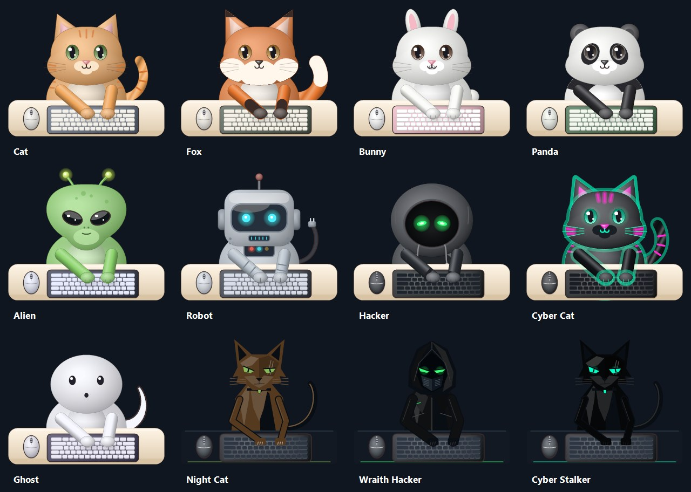
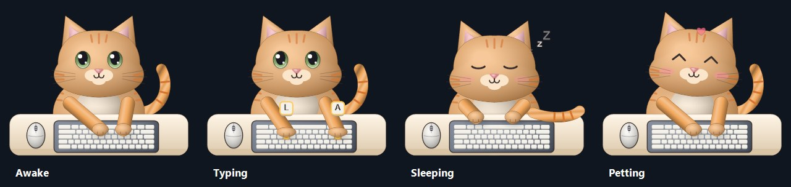

# stemCAT

**A desktop companion that types, clicks, and idles along with you.**

Twelve characters. Custom colours. A tiny keyboard of their own.
Available for Windows, with an early native macOS beta. No account, subscription, or network connection is required.

[**Download for Windows**](https://github.com/stemAGH/stemCAT/releases/latest/download/stemCAT.exe) · [**Mac beta**](https://github.com/stemAGH/stemCAT/releases/tag/mac-v2.1.0-beta.1) · [All releases](https://github.com/stemAGH/stemCAT/releases) · [Report an issue](https://github.com/stemAGH/stemCAT/issues)



## Download and run

1. Download **stemCAT.exe** using the link above. You do not need the source-code ZIP.
2. Keep the file in a permanent folder, such as `Documents\stemCAT`.
3. Double-click it. Your companion appears near the bottom-right corner of the screen, with an icon in the Windows system tray.
4. Start typing or moving your mouse. Right-click the character to choose another character or open Settings.

**This is a portable app, not a setup installer.** There is no installation wizard, and the executable runs on its own. It saves preferences separately in `%APPDATA%\stemCAT\settings.ini`.

**Requirements:** Windows 10 or 11 with .NET Framework 4.x available. No separate game engine or asset downloads are needed. For macOS, use the separate beta below. Linux is not supported.

The executable is currently unsigned, so Windows may show an unknown-publisher or SmartScreen warning. Download only from this repository's Releases page. A SHA-256 checksum is included with each release for checking the downloaded file.

## macOS beta

[**Download the Mac beta**](https://github.com/stemAGH/stemCAT/releases/tag/mac-v2.1.0-beta.1) · [Mac beta details and limitations](macos/RELEASE.md)

The universal Mac app targets **macOS 12+**, on Apple silicon and Intel. Extract the ZIP, move `stemCAT.app` to Applications, and launch it. Use its **stemCAT menu-bar item** to choose a character, colour preset, size, opacity, or click-through mode.

Choose **Enable keyboard reactions** and grant **Input Monitoring** in System Settings → Privacy & Security, then quit and reopen the app. Idle animations and local interactions work without this permission. **Control + Option + L** toggles click-through when keyboard monitoring is enabled; the menu-bar item remains available regardless.

The first Mac beta reuses the existing artwork as preset animation poses. It supports all twelve characters and their colour presets, typing/mouse activity, idle/sleep/petting, dragging, resizing, opacity, and green-screen mode. Exact per-key positioning, key labels, pointer-following eyes, custom colour editing, keyboard direction, launch at login, and separate mouse-button/scroll animations remain Windows-only. The feature and shortcut tables below describe the Windows edition.

**This beta is ad-hoc signed and not Apple-notarized. Gatekeeper may block it.** Developer ID signing and notarization are still required for a verified consumer release. Do not disable Gatekeeper. Real-Mac UI and permission testing is still outstanding; automated build checks are not a substitute for that testing.

Mac preferences use the `com.stemagh.stemcat` UserDefaults domain. The Mac app only keeps short-lived activity flags; it does not collect typed text or use the network.

### Building the Mac app

The [Mac workflow](.github/workflows/macos.yml) exports artwork from the C# renderer on Windows, then compiles the native AppKit host on macOS. It checks both architectures and all character atlases before packaging the ZIP. To build manually, compile `tools/ExportMacAssets.cs` with `Coat.cs`, `Character.cs`, `CatScene.cs`, and `DarkCharacters.cs` plus the System.Drawing and System.Web.Extensions references. Run the exporter with an output folder, copy that folder to `macos/Assets` on a Mac with Xcode command-line tools, then run `bash macos/build.sh` from the project root.

## What it does

| What you do | What your companion does |
| --- | --- |
| Type on your keyboard | Moves the appropriate paw to a matching key and lights it up. Optional keycap bubbles show the key label. |
| Move, click, or scroll your mouse | Uses its own mouse, with button and scroll feedback. |
| Move the pointer nearby | Looks toward it. Eye behaviour varies by character. |
| Leave it idle | Daydreams after about 12 seconds and sleeps after about 45 seconds. |
| Start typing again | Wakes up and returns to the keyboard. |
| Press and hold its head | Reacts to petting, with hearts or sparks depending on the character. |



The companion stays above ordinary desktop windows. Drag it to a convenient spot, resize it, or enable click-through mode so mouse clicks reach the window underneath.

## Meet the characters

| Character | Style |
| --- | --- |
| Cat | Classic desktop cat with 15 coat presets. |
| Fox | Pointed ears, contrasting paws, and a bushy tail. |
| Bunny | Long ears and a small puff tail. |
| Panda | Round ears and contrasting eye patches. |
| Alien | Antennae and dark, tilted eyes. |
| Robot | LED eyes, metal panels, and a cable tail. |
| Hacker | A hooded companion with glowing eyes and typing effects. |
| Cyber Cat | Neon details, glitches, and floating code bits. |
| Ghost | A floating spirit with a wispy tail. |
| Night Cat | A taller, angular cat with narrowed eyes and scar details. |
| Wraith Hacker | A pointed hood, concealed face, and respirator mask. |
| Cyber Stalker | A sharper neon cat with an elongated silhouette. |

The three darker designs are **additional choices**; the original Cat, Hacker, and Cyber Cat remain available. Each character has its own colour presets. You can also create and save custom palettes in Settings. The darker variants use a fixed dark desk and peripherals.

## Controls

| Action | Control |
| --- | --- |
| Open the menu | Right-click the character or its tray icon. |
| Open Settings | Choose **Settings**, or double-click the tray icon. |
| Move the character | Drag its body. Dragging farther while petting also moves it. |
| Pet the character | Press and hold its head. |
| Move to a corner or another monitor | Right-click → **Position**. |
| Enable or disable click-through | **Ctrl + Alt + L**. |
| Toggle privacy mode | **Ctrl + Alt + P**. |
| Close the app | Right-click → **Quit**. |

If clicks stop reaching the character, press **Ctrl + Alt + L** to turn click-through off. The tray menu also remains available.

## Make it yours

Settings and the right-click menu include:

- Character selection, colour presets, and saved custom palettes.
- Size and opacity controls.
- Keyboard direction: face the character or face the viewer.
- Optional key-label pop-ups.
- Position locking and monitor placement.
- A green-screen background for chroma-key capture in OBS.
- An optional **Start with Windows** setting.

If you enable startup, leave the executable in its chosen location. If you move it, launch it from the new location so its startup entry can be refreshed.

## Privacy and how it works

stemCAT uses Windows keyboard and mouse hooks to receive input events while you work in other apps. These events drive the paws, key lights, mouse, and animations. A transparent Windows Forms window draws the characters directly using `System.Drawing` vector shapes, at a target interval of about 33 ms per frame.

Input state and recent animation data are held in memory. **Keystrokes are not written to a log or sent to a server.** The app has no network features. Preferences, custom colours, and window position are saved locally.

**Privacy mode changes the on-screen display:** it hides key-label pop-ups and shows left/right activity instead of individual keys. It does not disable the input hooks. Use it when sharing or recording your screen; normal mode can reveal pressed keys visually.

## Build from source

1. Download the source ZIP from **Code → Download ZIP**, or clone this repository.
2. Extract it to a local folder.
3. Double-click `build.bat`.

The script uses the C# compiler included with .NET Framework, builds `stemCAT.exe`, and launches it. It downloads no dependencies. Building stops any running stemCAT instance before replacing the executable.

If the compiler cannot be found, check that .NET Framework is enabled in Windows Features.

### Checks and render previews

From PowerShell in the project folder:

```powershell
$csc = "$env:WINDIR\Microsoft.NET\Framework64\v4.0.30319\csc.exe"
if (!(Test-Path $csc)) { $csc = "$env:WINDIR\Microsoft.NET\Framework\v4.0.30319\csc.exe" }
$sources = 'Coat.cs','Character.cs','CatScene.cs','DarkCharacters.cs' |
    ForEach-Object { (Resolve-Path "src/$_").Path }
& $csc /nologo /target:exe /out:checks\DarkChecks.exe /r:System.Drawing.dll $sources (Resolve-Path checks/DarkChecks.cs).Path
& .\checks\DarkChecks.exe
Start-Process .\stemCAT.exe -ArgumentList '--render-test','previews' -Wait
```

The checks cover character identity, independent palettes, head hit areas, transparency, and keyboard-state preservation. The render command creates PNGs for characters, palettes, icons, and interaction states without starting the desktop overlay.

Releases are built and checked on a Windows GitHub Actions runner. Only the executable and its checksum are attached to the release; local development previews and temporary binaries are excluded from the repository.

## Troubleshooting

- **Nothing appears:** check the tray's hidden icons. The app may already be running. Use **Position** to move it onto the current monitor.
- **Cannot click or drag it:** press **Ctrl + Alt + L** and check whether position locking is enabled.
- **No key-name bubbles:** check **Key pop-ups** and whether privacy mode is on.
- **Input does not react in a particular app:** Windows privilege boundaries and some fullscreen applications can affect input hooks or overlays. Check behaviour with a normal desktop application first.
- **After an update:** quit the running app, replace the old executable, then launch the new one. Preferences stay in the AppData folder.

## Remove stemCAT

Turn off **Start with Windows** if enabled, choose **Quit**, and delete the executable. To also remove saved preferences, delete `%APPDATA%\stemCAT`.

Existing settings from the earlier DeskCat name are imported when no stemCAT settings file exists. If you used that version and want to remove all preferences, also remove its old `%APPDATA%\DeskCat` folder.


